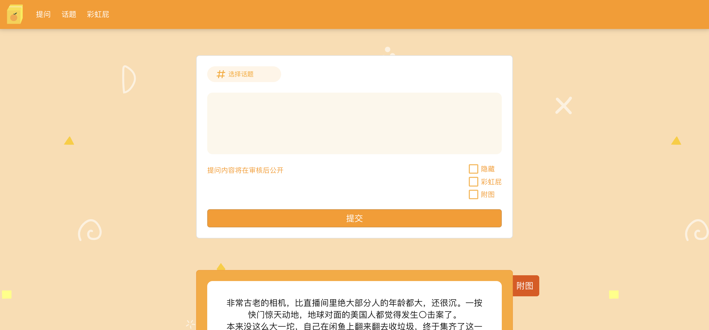

# JoiAsk 提问箱



样例可见 [轴伊Joi的提问箱](https://ask.vjoi.cn/)

## Quick Start 快速开始

### 使用 Docker（推荐）

#### 1. 准备配置文件

创建一个配置文件 `config.json`，最简单的配置示例（使用 SQLite）：

```json
{
    "db_type": "sqlite",
    "sqlite": "/work/db/jask.db",
    "server": {
        "host": "0.0.0.0",
        "port": 8080
    },
    "security": {
        "session_secret": ""
    },
    "storage_type": "local"
}
```

**启动前必须填写 `security.session_secret`**：运行以下命令，将输出填入上面的空字符串位置，并妥善保存配置，不要提交到仓库。该要求适用于所有部署，无论是否启用 B 站验证。

```bash
openssl rand -hex 32
```

已有部署请保留有效的密钥，不要每次启动都重新生成。详细要求和轮换影响见下方「Session 与 B 站验证安全配置」。

#### 2. 启动容器

```bash
docker run -d --restart always \
    --name joiask \
    -p 80:80 \
    -v $(pwd)/config.json:/work/config/config.json \
    -v $(pwd)/data:/work/db \
    -v $(pwd)/uploads:/work/frontend/public/upload-img \
    ghcr.io/xinrea/joiask:latest
```

#### 3. 创建管理员

**新安装没有默认管理员或默认密码。** 管理员 CLI 是离线运维命令：先停止所有连接此数据库的后端实例，再使用同版本镜像操作。在宿主机的 **Bash** 中执行以下命令，输入不会回显，也不会把密码放进命令参数、环境变量或 shell 历史。不要开启 `set -x`，不要用明文密码替换变量。`owner` 是自选用户名，可自行更换：

```bash
docker stop joiask
(
    set +x
    unset joiask_password
    IFS= read -r -s -p 'New administrator password: ' joiask_password || exit 1
    printf '\n' >&2
    builtin printf '%s\n' "$joiask_password" |
        docker run --rm -i --workdir /work --entrypoint /work/jask \
            -v "$(pwd)/config.json:/work/config/config.json:ro" \
            -v "$(pwd)/data:/work/db" \
            ghcr.io/xinrea/joiask:latest admin create owner
)
# 确认上面的命令成功后：
docker start joiask
```

`docker run` 使用 `-i` 传递标准输入，**不要加 `-t`**。镜像中的后端二进制是 `/work/jask`，上述命令复用同一配置和持久化数据库挂载，绕过 `start-joiask`，不会启动前端、Caddy 或 HTTP 服务。

#### 4. 访问服务

容器只暴露一个端口（80），内部 Caddy 自动处理路由：

- 前端提问箱: `http://localhost/`
- 管理后台: `http://localhost/admin`
- 后端 API: `http://localhost/api/`

用上一步创建的超级管理员账号登录后台。角色分为超级管理员（`super_admin`）和管理员（`admin`）：两者拥有相同的业务和站点配置权限，只有超级管理员可以管理后台管理员账号及角色。用户名本身不代表权限。

修改管理员密码或角色后，该账号所有已签发的登录会话（包括当前会话）都会失效，需要重新登录；只修改用户名、将密码留空或保持原角色不会撤销会话。删除管理员后，其旧会话也不能再获取管理员权限。所有管理员都能通过「个人资料」修改自己的用户名和密码，但普通管理员不能修改角色。不能删除当前登录账号，也不能删除或降级最后一个超级管理员。

### 管理员初始化与密码恢复（仅服务端）

普通启动会迁移表结构、角色和站点初始数据，但不会创建任何管理员。已有账号（无论是否叫 `admin`）及其密码保持不变；改名、删除账号或删除全部账号后，重启不会补回默认账号。升级不会自动更换历史弱密码：如果旧部署仍在使用 `admin` / `admin`，请立即在后台或通过下述命令重置密码。

**角色首次迁移规则：** 对尚未设置角色的历史账号，用户名恰好为小写 `admin` 的账号迁移为超级管理员，其他账号迁移为普通管理员。每个账号只迁移一次；后续改名或重启不会改变角色，已有 `role=admin` 的账号即使用户名为 `admin` 也不会自动升级。若没有该历史用户名，不会任选账号授予特权，需要运维显式执行 `promote` 或 `create`。升级时先停止所有后端实例，完成迁移后再恢复流量，不要混用新旧版本。

持有服务器/数据库访问权限的运维人员可使用同一个后端二进制。**执行任一 CLI 命令前，停止所有连接同一数据库的后端实例；命令完成后再启动服务。** CLI 会迁移管理员表结构，不支持在线运行：

```text
jask admin create <username>
jask admin reset-password <username>
jask admin promote <username>
```

- 密码只从标准输入读取到 EOF：一行非空密码，最多 4096 字节，可带末尾 LF/CRLF；其他空格原样保留。建议使用密码管理器生成独立的强密码。
- `create` 显式创建新的**超级管理员**，用户名已存在时报错，不覆盖原密码或角色。
- `reset-password` 仅修改已有账号，保留原角色，用户名不存在时报错；密码与会话版本在同一条数据库更新中修改，立即撤销该账号全部旧会话。
- `promote` 将已有账号显式提升为超级管理员，不读取或修改密码；角色变化时撤销其旧会话，重复提升已是超级管理员的账号不再修改会话版本。用户名不存在时报错。
- 命令失败以非零状态退出，不输出密码、密码散列或数据库错误中的 SQL；不会把管理员密码写入配置文件。
- 配置来源与服务一致：`JOIASK_CONFIG`，默认为当前工作目录的 `./config/config.json`。SQLite 相对路径也依赖当前工作目录，务必使用同一数据库，推荐绝对路径。命令只初始化管理员表，不启动服务；恢复命令不依赖 Session 密钥，但普通服务启动仍必须先通过 Session 密钥校验。
- 没有公开的管理员注册/恢复接口。恢复权限由服务器和数据库访问权限保护，请限制这些权限。

**容器重置密码：** 先停止全部后端实例，重用上面隐藏输入的 Bash 命令，只将镜像及子命令一行改为：

```bash
            ghcr.io/xinrea/joiask:latest admin reset-password owner
```

**容器无法启动时恢复：** 确认全部后端实例已停止。在宿主机的 Bash 中使用同版本镜像、相同配置和持久化数据库挂载，绕过 `start-joiask` 启动脚本（不启动前端、Caddy 或 HTTP 服务）：

```bash
(
    set +x
    unset joiask_password
    IFS= read -r -s -p 'New administrator password: ' joiask_password || exit 1
    printf '\n' >&2
    builtin printf '%s\n' "$joiask_password" |
        docker run --rm -i --workdir /work --entrypoint /work/jask \
            -v "$(pwd)/config.json:/work/config/config.json:ro" \
            -v "$(pwd)/data:/work/db" \
            ghcr.io/xinrea/joiask:latest admin reset-password owner
)
```

请按实际部署替换镜像版本和挂载目录；如果数据库中没有任何管理员，将 `reset-password` 改为 `create`。不要另挂一个空数据目录来「恢复」，那只会创建另一套数据库。

**没有超级管理员时提升现有账号：** 停止全部后端实例后执行，无需输入密码；如果忘记该账号密码，再单独执行 `reset-password`：

```bash
docker run --rm --workdir /work --entrypoint /work/jask \
    -v "$(pwd)/config.json:/work/config/config.json:ro" \
    -v "$(pwd)/data:/work/db" \
    ghcr.io/xinrea/joiask:latest admin promote owner
```

**本机构建/运行：** `go build -o jask ./cmd/cmd.go`，停止全部后端实例后在 Bash 中安全输入密码：

```bash
(
    set +x
    unset joiask_password
    IFS= read -r -s -p 'New administrator password: ' joiask_password || exit 1
    printf '\n' >&2
    builtin printf '%s\n' "$joiask_password" |
        JOIASK_CONFIG=/absolute/path/to/config.json ./jask admin create owner
)
```

不要将密码直接写入命令、日志、配置、脚本或版本库。以上示例将密码仅保存在短生命周期子 shell 的非导出变量中。

## 投稿格式标签

投稿页的格式工具栏支持以下标签，也可以直接在正文中输入：

| 效果 | 标签 |
| --- | --- |
| 隐藏 | `[hide]内容[/hide]` |
| 加粗 | `[bold]内容[/bold]` |
| 循环放大缩小 | `[big=1]内容[/big]` |
| 持续晃动 | `[shake=1]内容[/shake]` |

`big` 和 `shake` 的强度范围为 `0.1`～`3`，默认值为 `1`；效果可以嵌套使用。历史投稿中的 `{{隐藏内容}}` 写法继续受到支持。

## Build 构建

### 从源码构建

```bash
docker build -t joiask .
```

构建完成后运行：

```bash
docker run -d --restart always \
    --name joiask \
    -p 80:80 \
    -v $(pwd)/config.json:/work/config/config.json \
    -v $(pwd)/data:/work/db \
    -v $(pwd)/uploads:/work/frontend/public/upload-img \
    joiask
```

## Configuration 配置

### 数据库配置

以下完整示例的 `security.session_secret` 留空，首次运行前必须用 `openssl rand -hex 32` 的输出填写；已有部署保留有效密钥。

#### 使用 SQLite（推荐新手）

SQLite 是单文件数据库，无需额外安装数据库服务。

```json
{
    "db_type": "sqlite",
    "sqlite": "/work/db/jask.db",
    "server": {
        "host": "0.0.0.0",
        "port": 8080
    },
    "security": {
        "session_secret": ""
    },
    "storage_type": "local"
}
```

挂载数据目录：

```bash
-v $(pwd)/data:/work/db
```

#### 使用 MySQL

```json
{
    "db_type": "mysql",
    "mysql": {
        "host": "192.168.1.100",
        "port": 3306,
        "user": "root",
        "pass": "your_password",
        "name": "jask"
    },
    "server": {
        "host": "0.0.0.0",
        "port": 8080
    },
    "security": {
        "session_secret": ""
    },
    "storage_type": "local"
}
```

### Session 与 B 站验证安全配置

**所有部署（包括未启用 B 站验证的部署和本地开发）都必须配置 `security.session_secret`。** 使用下面的命令生成随机值，将输出的 64 个十六进制字符填入配置文件；不要直接使用示例中的空字符串，也不要将真实密钥提交到仓库：

```bash
openssl rand -hex 32
```

`session_secret` 去除首尾空白后必须至少 32 字节；校验通过后仍使用配置的原始字节签名，不会修改已有有效密钥。缺失、空字符串、纯空白，以及历史默认值 `WhyJoiIsSoCute`、旧示例值 `replace-with-a-long-random-secret`、旧开发值 `dev-only-session-secret-change-in-production`（包括这些值前后带空白的写法）都会被拒绝。后端会在初始化数据库之前报错退出，不会回退到任何默认密钥。

以下是安全配置片段，需合并到完整配置中。启用 B 站关注验证时，另行运行一次上述命令生成独立的 `bilibili_cookie_key`，不要与 Session 密钥共用：

```json
{
    "security": {
        "session_secret": "",
        "bilibili_cookie_key": "replace-with-an-independent-long-random-key",
        "secure_cookie": true
    }
}
```

- 将 Session 密钥保存在持久化的私有配置中，重启、重新构建和更新镜像时保持不变；同一部署的多个实例使用同一密钥。不要在每次启动时重新生成。
- 更换 Session 密钥会让所有用户（包括管理员）的现有登录会话失效，需要重新登录；尚未完成注册的用户也必须重新开始注册流程。仅更换此密钥不需要迁移业务数据；没有接受旧密钥的宽限期。
- HTTPS 部署应将 `secure_cookie` 设为 `true`；本地 HTTP 开发保持 `false`。
- `bilibili_cookie_key` 仅用于 B 站 Cookie 加密，与 Session 签名密钥相互独立。本次 Session 配置升级不要更换已有的 `bilibili_cookie_key`，以免影响已保存 Cookie 的解密。
- 未配置 `bilibili_cookie_key` 时，已有用户仍可登录，但不能配置验证账号或发起新注册验证。
- 可通过现有的 `JOIASK_CONFIG=/path/to/config.json` 指定配置文件；未设置时读取当前工作目录下的 `./config/config.json`。Session 密钥从该配置文件读取，没有单独的环境变量覆盖项。

### 图片存储配置

以下仅为存储配置片段，需合并到已配置 `security.session_secret` 的完整配置中。

上传文件的安全响应头、历史本地/OSS 文件排查及 CDN 配置要求见 [上传文件部署安全说明](doc/upload-serving-security.md)。本地 Caddy/Next 的防护不覆盖直接从 OSS/CDN 返回的文件。

#### 本地存储（推荐）

图片存储在容器的 `/work/frontend/public/upload-img/` 目录。

```json
{
    "storage_type": "local"
}
```

挂载存储目录：

```bash
-v $(pwd)/uploads:/work/frontend/public/upload-img
```

#### OSS 存储（阿里云）

使用阿里云 OSS 存储图片，适合大规模部署。

```json
{
    "storage_type": "oss",
    "oss": {
        "address": "https://your-domain.com",
        "endpoint": "oss-cn-beijing.aliyuncs.com",
        "access_key": "your_access_key",
        "secret_key": "your_secret_key",
        "bucket": "your-bucket-name"
    }
}
```

## 使用 Nginx 反向代理（HTTPS）

如果需要使用 HTTPS，可以在宿主机上配置 Nginx 反向代理：

```nginx
server {
    listen 443 ssl;
    server_name ask.example.com;

    ssl_certificate /path/to/cert.pem;
    ssl_certificate_key /path/to/key.pem;

    location / {
        proxy_pass http://localhost:80;
        proxy_http_version 1.1;
        proxy_set_header Upgrade $http_upgrade;
        proxy_set_header Connection 'upgrade';
        proxy_set_header Host $host;
        proxy_set_header X-Real-IP $remote_addr;
        proxy_set_header X-Forwarded-For $proxy_add_x_forwarded_for;
        proxy_set_header X-Forwarded-Proto $scheme;
    }
}
```

## 完整配置示例

以下示例中的 `security.session_secret` 故意留空。首次部署前运行 `openssl rand -hex 32` 并填入输出；已有部署保留其有效密钥。未填写时后端不会启动。

### 最小配置（SQLite + 本地存储）

```json
{
    "db_type": "sqlite",
    "sqlite": "/work/db/jask.db",
    "server": {
        "host": "0.0.0.0",
        "port": 8080
    },
    "security": {
        "session_secret": ""
    },
    "storage_type": "local"
}
```

### 生产环境配置（MySQL + OSS）

此示例假定通过 HTTPS 访问，因此启用 `secure_cookie`。

```json
{
    "db_type": "mysql",
    "mysql": {
        "host": "192.168.1.100",
        "port": 3306,
        "user": "joiask",
        "pass": "secure_password",
        "name": "joiask"
    },
    "server": {
        "host": "0.0.0.0",
        "port": 8080
    },
    "security": {
        "session_secret": "",
        "secure_cookie": true
    },
    "storage_type": "oss",
    "oss": {
        "address": "https://cdn.example.com",
        "endpoint": "oss-cn-beijing.aliyuncs.com",
        "access_key": "your_access_key",
        "secret_key": "your_secret_key",
        "bucket": "joiask-images"
    }
}
```

## Docker Compose（可选）

先按快速开始准备并填写 `config.json`（包括必填的 `security.session_secret`），再创建 `docker-compose.yml`：

```yaml
version: '3.8'

services:
  joiask:
    image: ghcr.io/xinrea/joiask:latest
    container_name: joiask
    restart: always
    ports:
      - "80:80"
    volumes:
      - ./config.json:/work/config/config.json
      - ./data:/work/db
      - ./uploads:/work/frontend/public/upload-img
```

启动：

```bash
docker-compose up -d
```

## 更新容器

**先更新配置，再切换到新镜像。** 新版不会为缺失或无效的 Session 密钥提供默认值，直接升级会导致后端在数据库初始化前退出。容器启动脚本会随之停止前端和 Caddy；配合 `restart: always` / `--restart always` 会反复重启，整个站点将不可用，直到修正配置。

1. 检查当前实际挂载的 `config.json`。若 `security.session_secret` 缺失或无效，先运行 `openssl rand -hex 32`，将输出填入该字段并持久保存；已有有效密钥无需更换。不要修改已有的 `bilibili_cookie_key`。
2. 旧版本已支持配置 `security.session_secret`，可先重启旧版本使新密钥生效，再更新镜像。密钥切换时所有用户都需重新登录，未完成注册的用户需重新开始；没有旧密钥宽限期，也无需为此迁移业务数据。
3. 确认配置已就绪后，执行下列容器更新步骤。后续更新继续使用同一密钥，不要随镜像更新轮换。

管理员会话版本字段会在后端启动时自动迁移。升级到支持会话版本校验的版本时，不带版本字段的历史管理员 cookie 会失效，管理员需重新登录；无需更换 Session 密钥，普通用户会话不受此项变更影响。多实例部署应在恢复流量前完成所有实例升级，避免旧实例继续接受已撤销的会话。

```bash
# 停止并删除旧容器
docker stop joiask && docker rm joiask

# 拉取最新镜像
docker pull ghcr.io/xinrea/joiask:latest

# 启动新容器
docker run -d --restart always \
    --name joiask \
    -p 80:80 \
    -v $(pwd)/config.json:/work/config/config.json \
    -v $(pwd)/data:/work/db \
    -v $(pwd)/uploads:/work/frontend/public/upload-img \
    ghcr.io/xinrea/joiask:latest
```

## 故障排查

### 查看容器日志

```bash
docker logs joiask
```

### 进入容器调试

```bash
docker exec -it joiask bash
```

### 常见问题

**Q: 容器启动后无法访问？**

- 检查端口是否被占用：`netstat -tlnp | grep 80`
- 检查防火墙设置
- 查看容器日志：`docker logs joiask`

**Q: 图片上传失败？**

- 检查存储目录是否正确挂载
- 如果使用 OSS，检查 access_key 和 bucket 配置
- 查看后端日志确认错误信息

**Q: 数据丢失？**

- 确保数据库文件和上传目录已正确挂载到宿主机
- 使用 `-v` 参数挂载目录，避免数据随容器删除而丢失

### 邮箱绑定与密码找回

在管理后台的「设置 → 邮件服务（SMTP）」中填写 SMTP 主机、端口、连接加密方式、用户名、密码或授权码、发件邮箱、发件人名称，以及前台网站的公开地址，然后开启邮件功能并保存。支持 STARTTLS（通常使用 587）、TLS / SSL（通常使用 465）和无需认证的本地邮件中继；远程 SMTP 认证需要加密连接。SMTP 密码保存在数据库中，不会通过配置接口返回，编辑时留空会保留原值。

注册流程保持原样，不要求邮箱。已注册用户登录后，未绑定邮箱时会显示带红点的邮箱图标。点击后输入邮箱和当前密码，收到确认邮件后打开链接并确认绑定。绑定完成后图标隐藏，悬停右上角用户名可查看已绑定邮箱。同一邮箱只能绑定一个账号，绑定后不支持更换。

用户可使用登录名或已绑定且已确认的邮箱登录；邮箱地址不区分大小写。关闭邮件功能后，已有绑定邮箱仍可用于登录。登录窗口的「忘记密码？」可向已绑定邮箱发送重置链接。邮件链接有效期为 30 分钟且只能使用一次；重置密码后，旧登录会话和其他尚未使用的重置链接失效。密码至少 8 个字符，最多 72 字节。请求接口对未绑定或已禁用的账号返回相同提示，发送请求有频率限制。

邮件功能默认关闭。关闭后邮箱绑定和密码找回入口隐藏，相关接口及邮件链接暂不可用，已有邮箱绑定信息会保留。数据库字段及邮件令牌表会在后端启动时自动迁移。
